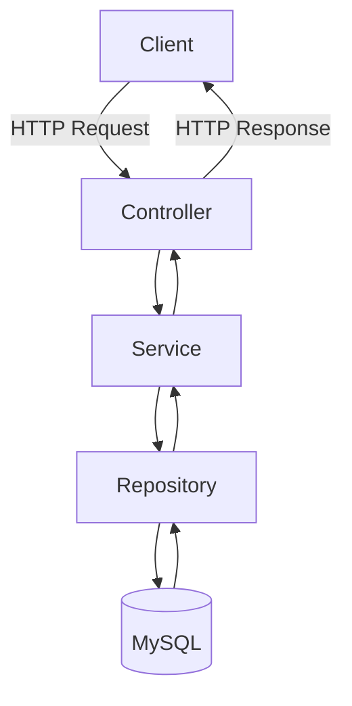

# アプリケーションの階層構造

## レイヤードアーキテクチャ

アプリケーションを役割ごとに複数の階層に分ける設計方法。

MotoManagerでは、主にController・Service・Repositoryの3つの階層に分けている。

## 各クラスの役割

| クラス | 役割 |
|---|---|
| Controller | HTTP通信の受付・応答 |
| Service | 業務処理・処理手順の管理 |
| Repository | データベース操作 |
| Entity | データベースに対応するオブジェクト |
| DTO | データの受け渡し |

## Controller

クライアントからのリクエストを受け取る窓口。

受け取った情報をServiceに渡し、処理結果をクライアントに返す。

## Service

アプリケーションに必要な処理を行う。

例えば、整備記録を登録する際には以下の処理を担当する。

1. 指定されたバイクが存在するか確認する。
2. バイクと整備記録を関連付ける。
3. Repositoryに保存を依頼する。

## Repository

データベースへのアクセスを担当する。

データの登録・取得・更新・削除などを行う。

## Entity

データベースのテーブルに対応するJavaクラス。

Javaオブジェクトとしてデータを扱うことができる。

## DTO

Data Transfer Objectの略。

クライアントとサーバーなどの間でデータを受け渡すためのオブジェクト。

Entityとは異なり、必ずしもデータベースの構造と一致する必要はない。

## 階層を分ける理由

- コードの役割を明確にできる
- 修正箇所を特定しやすい
- 同じ処理を再利用できる
- テストがしやすい
- 機能を追加しやすい

## 覚えておくこと

Controllerは通信を担当する。

Serviceは処理を担当する。

Repositoryはデータベース操作を担当する。

EntityとDTOは処理に使用するデータを表現するクラスであり、通信処理の階層そのものではない。

## 関連ノート

- [[06_EntityとJPA]]
- [[07_Repository]]
- [[08_Service]]
- [[09_Controller]]
- [[12_DTO]]

#設計 #アーキテクチャ
