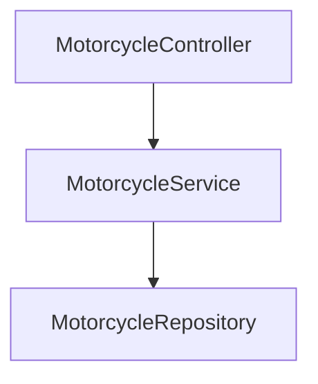

# 依存性注入（DI）

## DIとは

Dependency Injectionの略。

日本語では依存性注入と呼ばれる。

クラスが必要とするオブジェクトを、自分で生成するのではなく外部から受け取る仕組み。

## 依存関係とは

あるクラスが別のクラスを利用している関係。

MotoManagerでは以下の依存関係が存在する。



## コンストラクタインジェクション

```java
@Service
public class MotorcycleService {

    private final MotorcycleRepository
        motorcycleRepository;

    public MotorcycleService(
        MotorcycleRepository motorcycleRepository
    ) {
        this.motorcycleRepository =
            motorcycleRepository;
    }
}
```

Springが管理しているRepositoryのオブジェクトをコンストラクタの引数として受け取る。

自分でRepositoryのインスタンスを生成する必要はない。

## finalの意味

```java
private final MotorcycleRepository
    motorcycleRepository;
```

一度代入した参照を、別のオブジェクトに変更できないようにする。

## Beanとは

Springによって生成・管理されるオブジェクト。

## DIコンテナとは

Beanの生成や管理、依存関係の解決を行う仕組み。

## Springが管理する主なクラス

| アノテーションなど | 対象 |
|---|---|
| @Component | 一般的なコンポーネント |
| @Service | Service |
| @Repository | Repository |
| @RestController | REST Controller |
| @Bean | 設定クラスなどで生成するBean |
| JpaRepository | Spring Data JPAが実装を生成するRepository |

## @Autowiredについて

Springが依存関係を注入するためのアノテーション。

コンストラクタが1つだけの場合、通常は@Autowiredを省略できる。

## DIのメリット

- クラス同士の結び付きを弱くできる
- オブジェクトの生成をSpringに任せられる
- 実装の交換がしやすくなる
- テストがしやすくなる

## 関連ノート

- [[01_Spring Bootの基礎]]
- [[07_Repository]]
- [[08_Service]]
- [[09_Controller]]

#DI #Bean #コンストラクタ
