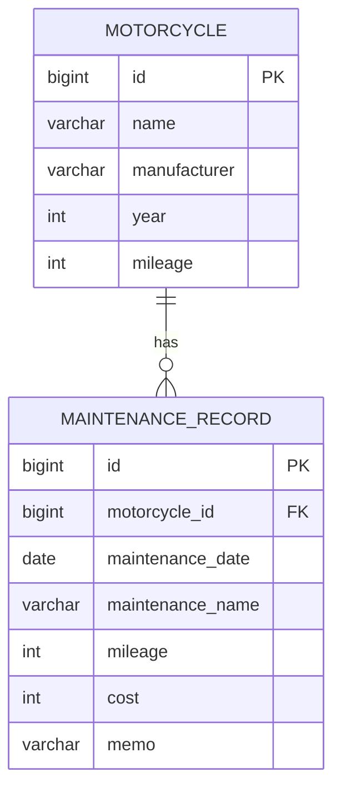

# テーブル間の関連付け

## リレーショナルデータベース

複数のテーブルをキーによって関連付けてデータを管理する。

MotoManagerでは、バイク情報と整備記録を別々のテーブルで管理している。

## ER図



## 1対多の関係

1台のバイクに対して複数の整備記録が存在する。

整備記録側から見ると、多対1の関係となる。

## 外部キーとは

別のテーブルのキーを参照するためのカラム。

maintenance_recordテーブルのmotorcycle_idは、motorcycleテーブルのidを参照する。

## JPAの関連付け

MaintenanceRecordクラスに以下のフィールドを記述する。

```java
@ManyToOne
@JoinColumn(
    name = "motorcycle_id",
    nullable = false
)
private Motorcycle motorcycle;
```

### @ManyToOne

複数の整備記録が1台のバイクに関連することを示す。

### @JoinColumn

関連付けに使用する外部キーのカラムを指定する。

### nullable = false

外部キーカラムにNULLを許可しない設定。

## なぜLong型ではなくMotorcycle型なのか

JPAではテーブル同士の関連をJavaオブジェクト同士の関連として扱うことができる。

```java
private Motorcycle motorcycle;
```

このように記述することで、整備記録から関連するバイク情報を参照できる。

```java
record.getMotorcycle().getName();
```

## Serviceでの関連付け

```java
Motorcycle motorcycle =
    motorcycleRepository.findById(motorcycleId)
        .orElseThrow(() ->
            new RuntimeException(
                "バイクが見つかりません"
            )
        );

record.setMotorcycle(motorcycle);

return maintenanceRecordRepository.save(record);
```

### 処理の流れ

1. バイクのIDを受け取る。
2. Repositoryからバイクを取得する。
3. 整備記録にMotorcycleオブジェクトを設定する。
4. 整備記録を保存する。
5. JPAが外部キーの値を管理する。

## 外部キー制約

存在しないバイクのIDを参照するなど、不整合なデータの登録を防止する仕組み。

整備記録が残っているバイクを削除しようとすると、外部キー制約によってエラーになる場合がある。

現在のMotoManagerでは、整備記録を先に削除してからバイクを削除する。

## 主な関連付けアノテーション

| アノテーション | 関係 |
|---|---|
| @OneToOne | 1対1 |
| @OneToMany | 1対多 |
| @ManyToOne | 多対1 |
| @ManyToMany | 多対多 |

## 関連ノート

- [[06_EntityとJPA]]
- [[08_Service]]
- [[12_DTO]]

#外部キー #ER図 #ManyToOne
