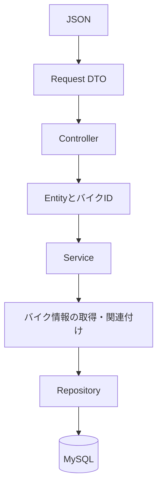

# DTO

## DTOとは

Data Transfer Objectの略。

データを受け渡すためのオブジェクト。

主にクライアントから送信されたデータの受け取りや、クライアントに返すデータの整理に使用する。

## Entityとの違い

| 項目 | Entity | DTO |
|---|---|---|
| 目的 | 永続化するデータの表現 | データの受け渡し |
| @Entity | 必要 | 不要 |
| JPAによる管理 | される | 通常されない |
| DB構造との対応 | あり | 必須ではない |

## MotoManagerでDTOが必要になった理由

MaintenanceRecordのEntityには以下のフィールドが存在する。

```java
private Motorcycle motorcycle;
```

しかし、クライアントから整備記録を登録する際には、バイクの情報をすべて送信する必要はない。

バイクのIDだけを送信すればよい。

```json
{
    "motorcycleId": 2,
    "maintenanceDate": "2026-11-26",
    "maintenanceName": "オイル交換",
    "mileage": 55100,
    "cost": 3000,
    "memo": "定期交換"
}
```

そのため、リクエスト専用のDTOを用意する。

## MaintenanceRecordRequest

```java
public class MaintenanceRecordRequest {

    private Long motorcycleId;
    private LocalDate maintenanceDate;
    private String maintenanceName;
    private int mileage;
    private Integer cost;
    private String memo;
}
```

※ Getter・Setter・importは省略。

## LocalDateとは

Javaで年月日を扱うためのクラス。

時刻やタイムゾーンを持たない。

JSONでは通常YYYY-MM-DD形式で受け取る。

## DTOからEntityへの変換

```java
@PostMapping
public MaintenanceRecord save(
    @RequestBody MaintenanceRecordRequest request
) {
    MaintenanceRecord record =
        new MaintenanceRecord();

    record.setMaintenanceDate(
        request.getMaintenanceDate()
    );

    record.setMaintenanceName(
        request.getMaintenanceName()
    );

    record.setMileage(request.getMileage());
    record.setCost(request.getCost());
    record.setMemo(request.getMemo());

    return maintenanceRecordService.save(
        record,
        request.getMotorcycleId()
    );
}
```

## requestとrecordの違い

requestはクライアントから受け取ったDTO。

recordはデータベースに保存するためのEntity。

DTOから必要な値を取り出し、Entityに設定している。

```java
record.setCost(request.getCost());
```

request.getCost()でDTOの金額を取得する。

record.setCost()でEntityに金額を設定する。

## motorcycleIdだけ別に渡す理由

EntityのmotorcycleフィールドはMotorcycle型である。

DTOのmotorcycleIdはLong型である。

そのため、ServiceでIDを使用してMotorcycleオブジェクトを取得する必要がある。

## データの変換イメージ



## Request DTOとResponse DTO

Request DTOはリクエストの受け取りに使用する。

Response DTOはクライアントに返す情報を整理するために使用する。

現在のMotoManagerでは整備記録のRequest DTOを実装している。

Response DTOは今後の改善項目である。

## 関連ノート

- [[09_Controller]]
- [[11_テーブル間の関連付け]]
- [[13_CRUD処理の全体像]]

#DTO #Entity #JSON
