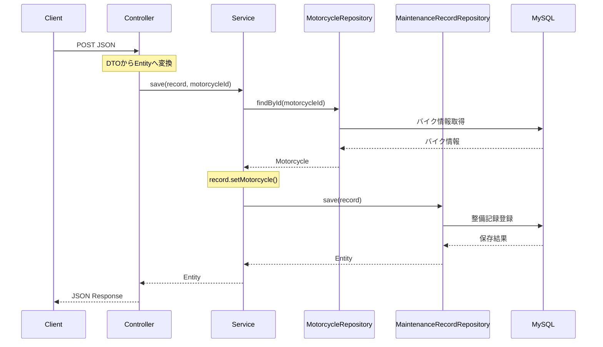

# CRUD処理の全体像

## CRUDとは

データを扱うアプリケーションにおける4つの基本操作。

- Create：登録
- Read：取得
- Update：更新
- Delete：削除

## Create：整備記録の登録



## Read：全件取得

```text
GET Request
    ↓
Controller.findAll()
    ↓
Service.findAll()
    ↓
Repository.findAll()
    ↓
MySQL
    ↓
List<Entity>
    ↓
JSON Response
```

Repositoryから取得したListがControllerに返され、JSON配列に変換される。

## Update：更新

```text
PUT Request
    ↓
Controller.update(id, request)
    ↓
Service.update(...)
    ↓
Repository.findById(id)
    ↓
既存Entityの値を変更
    ↓
Repository.save(existing)
    ↓
JSON Response
```

更新時には、対象のデータが存在するかを確認してから値を変更する。

## Delete：削除

```text
DELETE Request
    ↓
Controller.delete(id)
    ↓
Service.delete(id)
    ↓
Repository.existsById(id)
    ↓
Repository.deleteById(id)
    ↓
MySQL
    ↓
HTTP Response
```

## データの種類を整理する

| 処理段階 | データ形式 |
|---|---|
| クライアントから送信 | JSON |
| Controllerで受け取り | DTOまたはEntity |
| Serviceで処理 | Javaオブジェクト |
| Repositoryで保存 | Entity |
| MySQLで管理 | テーブル・レコード |
| クライアントへ返却 | JSON |

## 重要な考え方

クライアントは直接データベースを操作しない。

APIを通してバックエンドに処理を依頼する。

バックエンドが処理のルールを管理し、Repositoryを通してデータベースを操作する。

## 関連ノート

- [[04_アプリケーションの階層構造]]
- [[08_Service]]
- [[09_Controller]]
- [[12_DTO]]
- [[14_curlによるAPIテスト]]

#CRUD #処理フロー #シーケンス図
